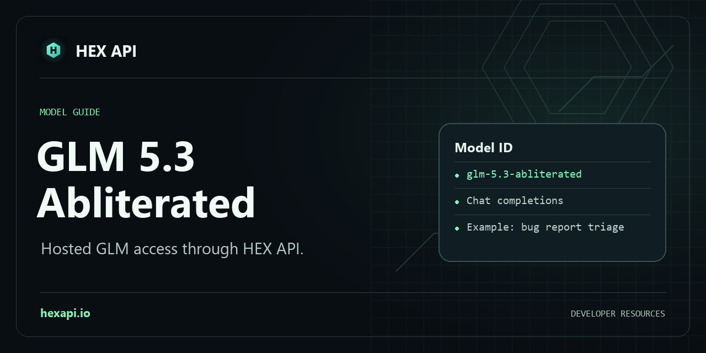

# GLM 5.3 Abliterated API

Call the hosted abliterated GLM model from your own code using HEX. Start with a small prompt and verify that the output fits the task before building it into a workflow.

| Setting | Value |
| --- | --- |
| Model ID | `glm-5.3-abliterated` |
| Base URL | `https://api.hexapi.io/v1` |
| Authentication | Bearer token from your HEX account |

## Example · Turn a rough bug report into a ticket

~~~bash
curl --fail-with-body https://api.hexapi.io/v1/chat/completions \
  -H "Authorization: Bearer $HEX_API_KEY" \
  -H "Content-Type: application/json" \
  --data '{
    "model": "glm-5.3-abliterated",
    "messages": [{
      "role": "user",
      "content": "Turn this fictional bug report into a title, reproduction steps, expected behavior, and actual behavior. Mark missing details as unknown. Report: In landscape view on a small screen, the save button disappears after opening the settings drawer."
    }],
    "max_tokens": 512
  }'
~~~

Look for the four requested sections. The ticket should preserve the reported behavior and leave the device and browser unspecified. Check `finish_reason` if the response stops before all sections arrive, especially when you set a small output cap.

[Browse models](https://hexapi.io/models) · [See current token rates](https://hexapi.io/pricing) · [Read the API docs](https://hexapi.io/docs)
